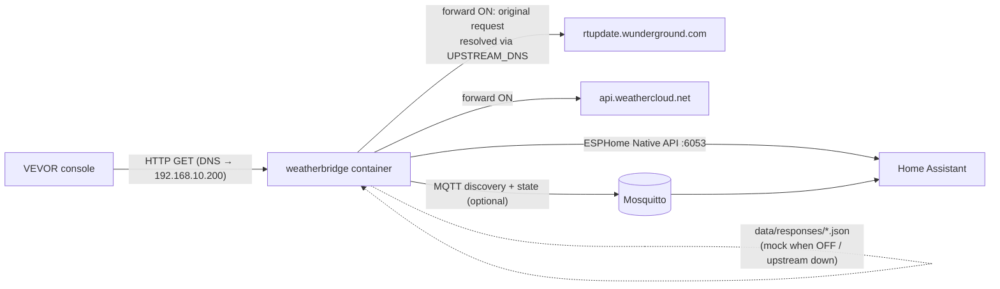

# VEVOR Weatherbridge – local WU / Weathercloud proxy for Home Assistant

A small Dockerized service that sits between a VEVOR weather station console (tested target:
**YT60234**, works with any console speaking the Weather Underground upload protocol) and the
cloud. It:

1. **Intercepts** the console's uploads to Weather Underground (WU) and Weathercloud (WC)
   (the router's DNS points both hostnames at this container).
2. **Publishes** the WU data to Home Assistant (metric units) through one or both backends:
   * **ESPHome Native API**: the container acts as an ESPHome device; HA adds it with the
     built-in ESPHome integration, no MQTT broker needed. Plaintext or encrypted (Noise key).
   * **MQTT discovery** through a broker (e.g. the Mosquitto add-on).
3. **Forwards** the original request to the real service and returns the **original
   response** to the console, recording it.
4. When forwarding is **off** or the upstream **fails**, answers the console with the
   **recorded response** (mock), so the console never sees an error caused by the proxy.
5. Forwarding is switchable **at runtime from Home Assistant** (one switch for WU, one for WC).

Forked from [C9H13NO3-dev/VevorWeatherbridge](https://github.com/C9H13NO3-dev/VevorWeatherbridge) (CC0-1.0).

---

## Architecture



| Request | Recognised by | Parsed into HA | Forwarded to |
|---|---|---|---|
| `GET /weatherstation/updateweatherstation.php?...` (any path under `/weatherstation/`) | path, or `Host: *.wunderground.com` | yes | `Host` if it is a `wunderground.com` host, else `rtupdate.wunderground.com` |
| `GET /v01/set/wid/<id>/key/<key>/<name>/<value>/...` | path (`/v01/`, `/v1/`), or `Host: *.weathercloud.net` | no (diagnostics only) | `Host` if it is a `weathercloud.net` host, else `api.weathercloud.net` |
| `GET /healthz` | – | – | – |
| anything else | – | – | **404**, logged (masked) at INFO |

The proxy only ever forwards to the service's own domain. It never forwards to an arbitrary
`Host` header, so it cannot act as an open proxy.

### Forward / mock logic

| Situation | Console receives | Recorded |
|---|---|---|
| Forward ON, upstream 2xx | upstream status, body, content-type | yes → `data/responses/<wu\|wc>.json` |
| Forward ON, upstream 3xx/4xx (e.g. wrong station key) | upstream response unchanged | no |
| Forward ON, upstream 5xx, network error, DNS error, timeout | recorded response (or default) | no |
| Forward OFF | recorded response (or default) | no |

Defaults until something is recorded: WU `200 text/html "success\n"`, WC `200 text/plain "200"`.

**Upstream DNS:** upstream hosts are resolved **only** via `UPSTREAM_DNS` (default
`1.1.1.1,9.9.9.9`), never via the system / router resolver. The router resolves those
names to this container, so using it would create a loop.

### Framework change (Flask → aiohttp)

The upstream project used Flask with a fire-and-forget `requests` call and a write-only
paho client. This fork needs three things running at once: an upstream request whose
response goes back to the console, a long-lived MQTT subscription for the switches, and
reconnects with backoff. `aiohttp` + `aiomqtt` handle all three in one asyncio loop without
threads. MQTT publishing runs in the background, so a slow or absent broker never delays
the console's response.

---

## Home Assistant backends

Both backends are **off by default**; enable at least one in `.env` (the container exits with a
configuration error otherwise). Enabling both is possible but creates two HA devices with the
same data.

| | ESPHome (`ESPHOME_ENABLED=true`) | MQTT (`MQTT_ENABLED=true`) |
|---|---|---|
| Needs | nothing besides HA | MQTT broker + HA MQTT integration |
| Add in HA | **Settings → Devices & services → Add integration → ESPHome**, host = container IP, port 6053 (or accept the auto-discovered device via mDNS) | automatic (MQTT discovery) |
| Encryption | optional, `ESPHOME_ENCRYPTION_KEY` (base64, 32 bytes) like ESPHome `api.encryption.key` | broker TLS/auth |
| Protocol | ESPHome Native API (protobuf over TCP), implemented here as a server | official HA MQTT discovery |
| New weather field appears | HA is asked to reconnect and re-lists entities (a few seconds) | entity announced on the fly |

### ESPHome backend notes

* The protobuf messages come from the pinned [`aioesphomeapi`](https://github.com/esphome/aioesphomeapi)
  package, the same client library Home Assistant uses; the tests connect with that client
  (plaintext and Noise, wrong key, plaintext/encrypted mismatch, switch commands).
* The device reports API version 1.14, a fixed name (`ESPHOME_NAME`) and a fixed MAC
  (`ESPHOME_MAC`, by default derived from `DEVICE_ID`, locally administered). HA uses the MAC
  as the device's unique id, so do not change name or MAC after adding the device.
* Sensors are listed once their WU field has been received at least once (persisted in
  `data/state.json`), so fields the console never sends do not show up as `unknown`.
* `last_reading` and the upstream statuses are text sensors (timestamp as ISO-8601).
* mDNS (`ESPHOME_MDNS=true`) advertises `_esphomelib._tcp` for auto-discovery. If discovery
  does not work in your network, add the device by IP; mDNS is not required.
* The Native API is not a formally versioned public protocol. A future HA/ESPHome release may
  need an `aioesphomeapi` bump here; MQTT discovery is the more stable option.

## Home Assistant entities

One device named `Weather Station`, model `VEVOR YT60234` (configurable). Entity IDs below
assume `DEVICE_NAME=Weather Station` and are the same for both backends.

| Entity | WU field | Unit | device_class | state_class |
|---|---|---|---|---|
| `sensor.weather_station_temperature` | tempf | °C | temperature | measurement |
| `sensor.weather_station_humidity` | humidity | % | humidity | measurement |
| `sensor.weather_station_dew_point` | dewptf | °C | temperature | measurement |
| `sensor.weather_station_wind_chill` | windchillf | °C | temperature | measurement |
| `sensor.weather_station_indoor_temperature` | indoortempf | °C | temperature | measurement |
| `sensor.weather_station_indoor_humidity` | indoorhumidity | % | humidity | measurement |
| `sensor.weather_station_wind_speed` | windspeedmph | km/h | wind_speed | measurement |
| `sensor.weather_station_wind_gust` | windgustmph | km/h | wind_speed | measurement |
| `sensor.weather_station_wind_direction` | winddir | ° | – (mdi:compass) | – |
| `sensor.weather_station_rain_rate` | rainin | mm/h | precipitation_intensity | measurement |
| `sensor.weather_station_daily_rain` | dailyrainin | mm | precipitation | total_increasing |
| `sensor.weather_station_weekly_rain` | weeklyrainin | mm | precipitation | total_increasing |
| `sensor.weather_station_monthly_rain` | monthlyrainin | mm | precipitation | total_increasing |
| `sensor.weather_station_yearly_rain` | yearlyrainin | mm | precipitation | total_increasing |
| `sensor.weather_station_solar_radiation` | solarradiation | W/m² | irradiance | measurement |
| `sensor.weather_station_uv_index` | UV | – | – | measurement |
| `sensor.weather_station_relative_pressure` | baromin | hPa | atmospheric_pressure | measurement |
| `sensor.weather_station_absolute_pressure` | absbaromin | hPa | atmospheric_pressure | measurement |
| `sensor.weather_station_last_reading` | – | timestamp, diagnostic | | |
| `sensor.weather_station_upstream_wu_status` | – | last HTTP code or `error`, diagnostic | | |
| `sensor.weather_station_upstream_wc_status` | – | last HTTP code or `error`, diagnostic | | |
| `switch.weather_station_forward_to_wu` | – | forward to WU, config | | |
| `switch.weather_station_forward_to_weathercloud` | – | forward to Weathercloud, config | | |

* Weather sensors are announced the first time their field arrives.
* Conversions: °C = (°F − 32)·5/9, km/h = mph·1.609344, mm = in·25.4, hPa = inHg·33.8639.
  Values are rounded to 0.1, humidity and wind direction to integers.
* WU field names are matched **case-insensitively** (the YT60234 sends `solarRadiation`).
* Values `-9999`, empty and `NaN` are skipped (not published).
* MQTT only: `last_reading` attributes: request counters, upstream error counters, `last_seen_*`,
  forward state, `wu_fields` (names received) and `wu_unmapped` (unknown names, no values).
* No `weather.*` entity and no forecast are created; that is a separate step in HA.
* MQTT: entity IDs come from `default_entity_id` in the discovery payload (HA 2025.10+). The entity
  names also slugify to the same IDs (`Humidity` → `humidity`), so the result is the same
  on older versions.

### Home Assistant package (optional)

[`homeassistant/weather_station.yaml`](homeassistant/weather_station.yaml) adds
`sensor.weather_station_pressure_change_3h` (statistics `change` over 3 h of the relative
pressure). Copy it to `/config/packages/` (requires `packages: !include_dir_named packages`
under `homeassistant:` in `configuration.yaml`), check the configuration and restart HA.

### MQTT topics

| Topic | Content |
|---|---|
| `meteo_proxy/state` | single JSON state (retained); all entities read it via `value_template` |
| `meteo_proxy/status` | `online` / `offline` (LWT, retained) |
| `meteo_proxy/forward/wu/set`, `meteo_proxy/forward/wc/set` | switch commands `ON` / `OFF` |
| `homeassistant/status` | subscribed; on `online` discovery and state are re-published |
| `homeassistant/<sensor\|switch>/weather_station/<key>/config` | discovery (retained) |

The last values are accumulated and persisted in `data/state.json`. A request that lacks some
field does not break the templates of entities announced earlier, and values survive a restart.

---

## Configuration

All configuration goes in `.env` (copy from [`.env.example`](.env.example), which documents
every variable). `docker-compose.yml` only wires the environment together and contains no secrets.

| Variable | Default | Purpose |
|---|---|---|
| `DOCKER_NETWORK` | `br0` | external Docker network (compose interpolation) |
| `CONTAINER_IP` | `192.168.10.200` | fixed container IP (compose interpolation) |
| `ESPHOME_ENABLED` | `false` | ESPHome Native API backend |
| `ESPHOME_PORT` | `6053` | Native API port |
| `ESPHOME_NAME` | `weather-station` | ESPHome device name (a-z, 0-9, `-`) |
| `ESPHOME_MAC` | derived from `DEVICE_ID` | MAC reported to HA (device unique id) |
| `ESPHOME_ENCRYPTION_KEY` | – | base64 32-byte Noise key (`openssl rand -base64 32`); empty = plaintext |
| `ESPHOME_MDNS` | `true` | advertise the device via mDNS |
| `MQTT_ENABLED` | `false` | MQTT discovery backend |
| `MQTT_HOST` / `MQTT_PORT` | – / `1883` | broker (required when MQTT is enabled) |
| `MQTT_USER` / `MQTT_PASSWORD` | – | broker credentials |
| `FORWARD_WU` / `FORWARD_WC` | `true` | initial forward state (state saved by an HA toggle wins) |
| `UPSTREAM_DNS` | `1.1.1.1,9.9.9.9` | resolvers for upstream hosts |
| `UPSTREAM_TIMEOUT` | `8` | upstream timeout in seconds |
| `WU_USERNAME` / `WU_PASSWORD` | – | optionally override the station ID/key sent to WU |
| `DEVICE_ID` / `DEVICE_NAME` / `DEVICE_MODEL` / `DEVICE_MANUFACTURER` | `weather_station` / `Weather Station` / `VEVOR YT60234` / `VEVOR` | HA device (both backends) |
| `DISCOVERY_PREFIX` | `homeassistant` | HA MQTT discovery prefix |
| `BASE_TOPIC` | `meteo_proxy` | state / status / command topics |
| `UNITS` | `metric` | `imperial` publishes the raw WU units (°F, mph, in, inHg) |
| `TZ` | – | container time zone (logs) |
| `LOG_LEVEL` | `INFO` | `DEBUG`, `INFO`, `WARNING`, `ERROR` |

### Data directory (`./data` → `/data`)

| File | Content |
|---|---|
| `state.json` | forward switch state set from HA, last sensor values |
| `responses/wu.json`, `responses/wc.json` | last successful upstream response (`status`, `content_type`, `body`, `recorded_at`) |
| `last_request_wu.json`, `last_request_wc.json` | last request (masked): host, path, query, UA, parsed values, `unmapped_fields`, rejected values, response source |

### Security and logging

* `ID`, `PASSWORD` (WU query) and `wid`, `key` (WC path/query) are replaced with `***` in
  logs, `data/` files and MQTT. Full URLs are never logged. aiohttp's access log is disabled.
  A global log filter also scrubs these keys from third-party log records, e.g. aiohttp's
  parser error that quotes the raw request line.
* Logging: one INFO line per request (`WU: 14 fields → HA, forward 200`). Upstream failures
  and fallbacks to the recorded response are logged at WARNING.
* `GET /healthz` returns JSON: `ok`, enabled backends, `mqtt_connected`, `esphome_clients`, forward state, counters, `last_seen`,
  last upstream statuses. The image `HEALTHCHECK` uses it. The container stays healthy while
  MQTT is down, because serving the console is the critical path.

---

## Deployment (UnRAID)

Target: UnRAID host with Docker + Compose Manager. The container gets its own LAN IP on the
ipvlan network (`br0`), so it can listen on port 80 without clashing with the host.

> **ipvlan caveat:** the UnRAID host itself cannot reach containers on the ipvlan network.
> Run all tests (`curl`) from **another machine** in the LAN.

### 1. Get the code and configure

```bash
cd /mnt/user/appdata
git clone https://github.com/piciuok/meteostation-mitm.git vevor-weatherbridge
cd vevor-weatherbridge
cp .env.example .env
nano .env        # enable a backend (ESPHOME_ENABLED and/or MQTT_ENABLED), check CONTAINER_IP, DOCKER_NETWORK
docker network ls   # confirm the ipvlan network name (br0)
```

### 2a. Run, local build

```bash
docker compose up -d --build
```

The image is tagged `vevor-weatherbridge:local` and labelled `wud.watch=false`, so WUD ignores it.

### 2b. Run, prebuilt image from GHCR

CI publishes `ghcr.io/piciuok/meteostation-mitm` (`latest` from `main`, `X.Y.Z` / `X.Y` from `v*` tags).
WUD can track this image.

```bash
docker compose -f docker-compose.ghcr.yml pull
docker compose -f docker-compose.ghcr.yml up -d
```

If the package is private, run `docker login ghcr.io` on the host first, or make the package
public in the GitHub package settings.

With Compose Manager, point the stack at `/mnt/user/appdata/vevor-weatherbridge`, or paste
the content of the chosen compose file. `.env` is read from the same directory.

### 3. Verify (from another LAN machine)

```bash
curl -s http://192.168.10.200/healthz
```

```bash
curl -s -H 'Host: rtupdate.wunderground.com' 'http://192.168.10.200/weatherstation/updateweatherstation.php?ID=X&PASSWORD=Y&tempf=50&solarRadiation=100&baromin=29.92'
```

Expected: `success` (or the recorded WU response). Then check `data/last_request_wu.json`
(ID/PASSWORD shown as `***`).

**ESPHome backend:** in HA go to **Settings → Devices & services**. Either confirm the
discovered `weather-station` device, or **Add integration → ESPHome**, host `192.168.10.200`,
port `6053`, and enter `ESPHOME_ENCRYPTION_KEY` when asked (only if you set one). The
`Weather Station` device appears with the sensors received so far.

**MQTT backend:** the `Weather Station` device appears in the MQTT integration automatically.

### 4. Redirect the console to the container (DNS)

The console resolves `rtupdate.wunderground.com` (and `api.weathercloud.net` if Weathercloud is
enabled on it) through the DNS server it got via DHCP. Make that DNS server answer both names
with the container IP. Pick **one** of the variants below. Examples use `192.168.10.200`.

Check before you start:

* The console must use the DNS server you change (normally the router, handed out by DHCP).
  If it has a hard-coded DNS server, see [Console with a hard-coded DNS server](#console-with-a-hard-coded-dns-server).
* The upload must be plain HTTP (port 80). Check the router's connection table or a packet
  capture. If WU goes over 443/HTTPS, it cannot be intercepted this way.
* Hosts-style entries (Pi-hole, OpenWrt Hostnames, OPNsense/pfSense overrides, MikroTik static)
  match the **exact** name only. Add every hostname the console really uses (check the DNS log
  or cache of your resolver).

Verify from any LAN machine that uses the same DNS server:

```bash
nslookup rtupdate.wunderground.com
```

Expected answer: `192.168.10.200`. Then power-cycle the console (it caches DNS) and watch
`docker logs -f vevor-weatherbridge` for `WU: … fields → HA` lines.

#### Variant A: local DNS server (Pi-hole, AdGuard Home)

Use this when your router cannot create custom DNS records (e.g. AVM FRITZ!Box, stock ASUS
firmware, consumer TP-Link Archer/Deco). Hand out the Pi-hole/AdGuard IP as DNS server in the
router's DHCP settings.

**Pi-hole v6** ([docs](https://docs.pi-hole.net/ftldns/configfile/#hosts)):
UI **Settings → Local DNS Records**, add both names with `192.168.10.200`. CLI equivalent
(replaces the whole `dns.hosts` list, so include your existing entries):

```bash
sudo pihole-FTL --config dns.hosts '[ "192.168.10.200 rtupdate.wunderground.com api.weathercloud.net" ]'
```

In the Pi-hole Docker image the same key is set with the `FTLCONF_dns_hosts` environment variable.

**AdGuard Home** ([docs](https://adguard-dns.io/kb/adguard-home/faq/)):
UI **Filters → DNS rewrites → Add DNS rewrite**: domain `rtupdate.wunderground.com`, answer
`192.168.10.200`; the same for `api.weathercloud.net`. YAML equivalent in `AdGuardHome.yaml`
(edit only while AdGuard Home is stopped, otherwise it overwrites the file):

```yaml
filtering:
  rewrites:
    - domain: rtupdate.wunderground.com
      answer: 192.168.10.200
      enabled: true
    - domain: api.weathercloud.net
      answer: 192.168.10.200
      enabled: true
```

**Plain dnsmasq** ([man page](https://thekelleys.org.uk/dnsmasq/docs/dnsmasq-man.html)), then restart dnsmasq:

```
address=/rtupdate.wunderground.com/192.168.10.200
address=/api.weathercloud.net/192.168.10.200
```

`address=` also matches subdomains. Since dnsmasq 2.86 queries of another type (AAAA) for these
names are forwarded upstream; add `local=/rtupdate.wunderground.com/` (and the same for
Weathercloud) if the console uses IPv6.

#### Variant B: router with local DNS records

**OpenWrt** (LuCI, OpenWrt 25.12: **Network → DNS → DNS Records → Hostnames**; 24.10:
**Network → DHCP and DNS**). CLI:

```bash
uci add dhcp domain
uci set dhcp.@domain[-1].name='rtupdate.wunderground.com'
uci set dhcp.@domain[-1].ip='192.168.10.200'
uci add dhcp domain
uci set dhcp.@domain[-1].name='api.weathercloud.net'
uci set dhcp.@domain[-1].ip='192.168.10.200'
uci commit dhcp
/etc/init.d/dnsmasq restart
```

DNS rebind protection (on by default) only filters private IPs in *upstream* answers, local
entries are not affected.

**OPNsense** ([docs](https://docs.opnsense.org/manual/unbound.html)):
**Services → Unbound DNS → Overrides → Host overrides → +**: Host `rtupdate`, Domain
`wunderground.com`, Type A, IP `192.168.10.200`; then Host `api`, Domain `weathercloud.net`. Apply.

**pfSense** ([docs](https://docs.netgate.com/pfsense/en/latest/services/dns/resolver-host-overrides.html)):
**Services → DNS Resolver → General Settings → Host Overrides → Add**: Host `rtupdate`,
Domain `wunderground.com`, IP `192.168.10.200`; the same for `api` / `weathercloud.net`.
Save, Apply Changes. Only clients using the firewall as DNS are affected.

**UniFi Network** ([help article](https://help.ui.com/hc/en-us/articles/15179064940439)):
Network 9.4+: **Settings → Policy Table → Create New Policy → DNS**, type **Host (A)**, domain
`rtupdate.wunderground.com`, IP `192.168.10.200` (Network 9.3: **Settings → Policy Engine → DNS**).
Repeat for `api.weathercloud.net`. Clients must use the gateway as DNS.

**TP-Link Omada** ([docs](https://support.omadanetworks.com/us/document/40077/), controller
5.15.20+ with an Omada gateway): **Network Config → Network Settings → LAN → LAN DNS**, type
**IP**, both names → `192.168.10.200`.

**ASUS with Asuswrt-Merlin** ([wiki](https://github.com/RMerl/asuswrt-merlin.ng/wiki/Custom-domains-with-dnsmasq)):
enable **Administration → System → Enable JFFS custom scripts and configs**, create
`/jffs/configs/dnsmasq.conf.add` with the two `address=` lines from the dnsmasq example
above, then run `service restart_dnsmasq`. Stock ASUS firmware has no custom DNS records; use
variant A.

#### Variant C: MikroTik (RouterOS 7)

The router must answer DNS for LAN clients (`/ip dns set allow-remote-requests=yes`, block port
53 from WAN in the firewall) and DHCP must hand out the router IP as DNS server.

```bash
/ip dns static add name=rtupdate.wunderground.com type=A address=192.168.10.200 comment="vevor-weatherbridge"
```

```bash
/ip dns static add name=api.weathercloud.net type=A address=192.168.10.200 comment="vevor-weatherbridge"
```

```bash
/ip dns cache flush
```

#### Console with a hard-coded DNS server

If the console ignores DHCP and asks e.g. `8.8.8.8` directly, redirect its DNS traffic (port
53) to your resolver on the router. These are common community patterns, not vendor-documented
recipes; adapt interface names and test.

MikroTik (only the console, `192.168.10.89`, to the router's own resolver):

```bash
/ip firewall nat add chain=dstnat src-address=192.168.10.89 protocol=udp dst-port=53 action=redirect to-ports=53 comment="vevor-weatherbridge"
```

```bash
/ip firewall nat add chain=dstnat src-address=192.168.10.89 protocol=tcp dst-port=53 action=redirect to-ports=53 comment="vevor-weatherbridge"
```

OpenWrt: see the official guide [DNS hijacking](https://openwrt.org/docs/guide-user/firewall/fw3_configurations/intercept_dns)
(a `redirect` rule from `lan`, `src_dport 53`, target `DNAT`).

Redirecting port 53 does not help if the console uses DNS-over-HTTPS/TLS or a hard-coded IP
address instead of a hostname.

### 5. Rollback

Remove (or disable) the DNS entries from step 4 and flush the resolver cache; the console then
talks to the cloud directly again after its own DNS cache expires (power-cycle it to be sure).
MikroTik example:

```bash
/ip dns static disable [find comment="vevor-weatherbridge"]
```

```bash
/ip dns cache flush
```

Pi-hole: delete the entries in **Settings → Local DNS Records**; AdGuard Home: delete the DNS
rewrites; OpenWrt/OPNsense/pfSense/UniFi/Omada: delete the host entries created in step 4.

Then stop the stack with `docker compose down`. With MQTT, HA entities become `unavailable`
through the LWT; delete the device in the MQTT integration to remove them (or publish empty
retained payloads to `homeassistant/+/weather_station/+/config`). With ESPHome, delete the
device in the ESPHome integration.

To reset the forward state to the `.env` defaults, delete `data/state.json` and restart.

---

## Development

```bash
pip install -r requirements-dev.txt
```

```bash
pytest -q
```

The tests use a local fake upstream HTTP server, a fake MQTT client and the real
`aioesphomeapi` client. They cover conversions, case-insensitive fields, WC path parsing,
masking across logs, files and MQTT, forward on/off, upstream down or timeout, MQTT and ESPHome
switch toggling with persistence, MQTT discovery payloads, and the ESPHome Native API
(plaintext, Noise, wrong key, entity list, state push, re-list on new fields).

CI:

| Workflow | When | What |
|---|---|---|
| `ci.yml` | push, PR, `v*` tags | `pytest`, then builds and pushes the image to GHCR (push to `main` / tags) |
| `esphome-compat.yml` | weekly (Mon 04:17 UTC), manual, changes to the ESPHome code | ESPHome tests against `aioesphomeapi` versions: `pinned` (requirements), `ha-stable` (pinned by the latest Home Assistant release), `ha-dev` (HA dev branch), `latest` (PyPI). A failed scheduled run opens or updates the issue "ESPHome compatibility check failed". |

Check the versions locally with `python scripts/esphome_versions.py ha-stable`.

Code layout:

| Path | Purpose |
|---|---|
| `weatherstation.py` | entry point |
| `weatherbridge/app.py` | aiohttp app, request handling, forward/mock |
| `weatherbridge/parsing.py` | WU field table + conversions, WC parsing, masking helpers |
| `weatherbridge/upstream.py` | resolver via `UPSTREAM_DNS`, forwarder, recorded responses |
| `weatherbridge/mqtt.py` | MQTT backend: HA discovery, state publishing, switch commands, reconnect |
| `weatherbridge/esphome.py` | ESPHome backend: Native API server (plaintext/Noise), entities, mDNS |
| `weatherbridge/state.py` | runtime state + `data/state.json` |
| `weatherbridge/logsafe.py` | global log scrubbing of credentials |

---

## Known issues / open questions

* **ESPHome Native API** is implemented by this project on top of `aioesphomeapi`'s protobuf
  definitions; it is not an official ESPHome device. The weekly `esphome-compat` workflow
  tests it against the version Home Assistant uses.
* **Garbage solar radiation from the console** (upstream issue #9). Some consoles send
  malformed values such as `solarRadiation=-117.-5`. Reportedly, values above about 367 W/m²
  wrap to negative. One reporter fixed it by having VEVOR replace the console (display unit).
  The exact encoding is not known, so the bridge does **not** try to reconstruct the value.
  Unparseable values and negative values of non-negative quantities (radiation, UV, wind,
  rain, humidity, pressure) are rejected. They are logged at WARNING and listed under
  `invalid_values` in `last_request_wu.json`. No unit (lux vs W/m²) problem was reported.
* **Weathercloud format** is implemented from the common `/v01/set/wid/<id>/key/<key>/<name>/<value>`
  form (a query-string variant is accepted too). Confirm against real traffic in
  `data/last_request_wc.json`. WC values are not mapped to HA yet.
* Upload interval: about every 30 s according to upstream issue #8 (YT60233).

## License

[CC0 1.0 Universal](LICENSE).

## Acknowledgements

* Original relay by [C9H13NO3-dev](https://github.com/C9H13NO3-dev/VevorWeatherbridge),
  inspired by [@vlovmx](https://github.com/vlovmx).
