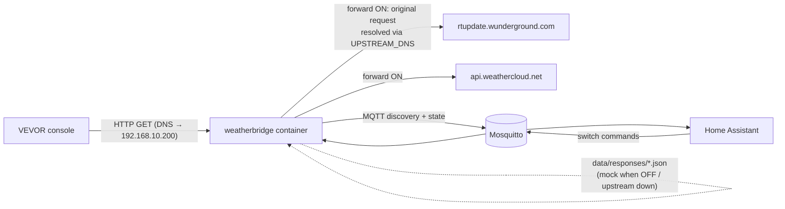

# VEVOR Weatherbridge – local WU / Weathercloud proxy for Home Assistant

A small Dockerized service that sits between a VEVOR weather station console (tested target:
**YT60234**, works with any console speaking the Weather Underground upload protocol) and the
cloud. It:

1. **Intercepts** the console's uploads to Weather Underground (WU) and Weathercloud (WC)
   (the router's DNS points both hostnames at this container).
2. **Publishes** the WU data to Home Assistant via **MQTT discovery** (metric units).
3. **Forwards** the original request to the real service and returns the **original
   response** to the console, recording it.
4. When forwarding is **off** or the upstream **fails**, answers the console with the
   **recorded response** (mock), so the console never sees an error caused by the proxy.
5. Forwarding is switchable **at runtime from Home Assistant** (one switch for WU, one for WC).

Forked from [C9H13NO3-dev/VevorWeatherbridge](https://github.com/C9H13NO3-dev/VevorWeatherbridge) (CC0-1.0).

---

## Architecture



| Request | Recognised by | Parsed into HA | Forwarded to |
|---|---|---|---|
| `GET /weatherstation/updateweatherstation.php?...` (any path under `/weatherstation/`) | path, or `Host: *.wunderground.com` | yes | `Host` if it is a `wunderground.com` host, else `rtupdate.wunderground.com` |
| `GET /v01/set/wid/<id>/key/<key>/<name>/<value>/...` | path (`/v01/`, `/v1/`), or `Host: *.weathercloud.net` | no (diagnostics only) | `Host` if it is a `weathercloud.net` host, else `api.weathercloud.net` |
| `GET /healthz` | – | – | – |
| anything else | – | – | **404**, logged (masked) at INFO |

The proxy only ever forwards to the service's own domain. It never forwards to an arbitrary
`Host` header, so it cannot act as an open proxy.

### Forward / mock logic

| Situation | Console receives | Recorded |
|---|---|---|
| Forward ON, upstream 2xx | upstream status, body, content-type | yes → `data/responses/<wu\|wc>.json` |
| Forward ON, upstream 3xx/4xx (e.g. wrong station key) | upstream response unchanged | no |
| Forward ON, upstream 5xx, network error, DNS error, timeout | recorded response (or default) | no |
| Forward OFF | recorded response (or default) | no |

Defaults until something is recorded: WU `200 text/html "success\n"`, WC `200 text/plain "200"`.

**Upstream DNS:** upstream hosts are resolved **only** via `UPSTREAM_DNS` (default
`1.1.1.1,9.9.9.9`), never via the system / router resolver. The router resolves those
names to this container, so using it would create a loop.

### Framework change (Flask → aiohttp)

The upstream project used Flask with a fire-and-forget `requests` call and a write-only
paho client. This fork needs three things running at once: an upstream request whose
response goes back to the console, a long-lived MQTT subscription for the switches, and
reconnects with backoff. `aiohttp` + `aiomqtt` handle all three in one asyncio loop without
threads. MQTT publishing runs in the background, so a slow or absent broker never delays
the console's response.

---

## Home Assistant entities

One device: `identifiers: [stacja_meteo]`, name `Stacja meteo`, model `VEVOR YT60234`
(configurable). Entity IDs below assume `DEVICE_ID=stacja_meteo`.

| Entity | WU field | Unit | device_class | state_class |
|---|---|---|---|---|
| `sensor.stacja_meteo_temperatura` | tempf | °C | temperature | measurement |
| `sensor.stacja_meteo_wilgotnosc` | humidity | % | humidity | measurement |
| `sensor.stacja_meteo_punkt_rosy` | dewptf | °C | temperature | measurement |
| `sensor.stacja_meteo_temperatura_odczuwalna` | windchillf | °C | temperature | measurement |
| `sensor.stacja_meteo_temperatura_konsola` | indoortempf | °C | temperature | measurement |
| `sensor.stacja_meteo_wilgotnosc_konsola` | indoorhumidity | % | humidity | measurement |
| `sensor.stacja_meteo_wiatr_predkosc` | windspeedmph | km/h | wind_speed | measurement |
| `sensor.stacja_meteo_wiatr_porywy` | windgustmph | km/h | wind_speed | measurement |
| `sensor.stacja_meteo_wiatr_kierunek` | winddir | ° | – (mdi:compass) | – |
| `sensor.stacja_meteo_opad_intensywnosc` | rainin | mm/h | precipitation_intensity | measurement |
| `sensor.stacja_meteo_opad_dzienny` | dailyrainin | mm | precipitation | total_increasing |
| `sensor.stacja_meteo_opad_tygodniowy` | weeklyrainin | mm | precipitation | total_increasing |
| `sensor.stacja_meteo_opad_miesieczny` | monthlyrainin | mm | precipitation | total_increasing |
| `sensor.stacja_meteo_opad_roczny` | yearlyrainin | mm | precipitation | total_increasing |
| `sensor.stacja_meteo_promieniowanie` | solarradiation | W/m² | irradiance | measurement |
| `sensor.stacja_meteo_uv` | UV | – | – | measurement |
| `sensor.stacja_meteo_cisnienie_wzgledne` | baromin | hPa | atmospheric_pressure | measurement |
| `sensor.stacja_meteo_cisnienie_absolutne` | absbaromin | hPa | atmospheric_pressure | measurement |
| `sensor.stacja_meteo_ostatni_odczyt` | – | timestamp, diagnostic | | |
| `sensor.stacja_meteo_upstream_wu_status` | – | last HTTP code or `error`, diagnostic | | |
| `sensor.stacja_meteo_upstream_wc_status` | – | last HTTP code or `error`, diagnostic | | |
| `switch.stacja_meteo_przekazuj_do_wu` | – | forward to WU, config | | |
| `switch.stacja_meteo_przekazuj_do_weathercloud` | – | forward to Weathercloud, config | | |

* Weather sensors are announced the first time their field arrives.
* Conversions: °C = (°F − 32)·5/9, km/h = mph·1.609344, mm = in·25.4, hPa = inHg·33.8639.
  Values are rounded to 0.1, humidity and wind direction to integers.
* WU field names are matched **case-insensitively** (the YT60234 sends `solarRadiation`).
* Values `-9999`, empty and `NaN` are skipped (not published).
* `ostatni_odczyt` attributes: request counters, upstream error counters, `last_seen_*`,
  forward state, `wu_fields` (names received) and `wu_unmapped` (unknown names, no values).
* No `weather.*` entity and no forecast are created; that is a separate step in HA.
* Entity IDs come from `default_entity_id` in the discovery payload (HA 2025.10+). The entity
  names also slugify to the same IDs (`Wilgotność` → `wilgotnosc`), so the result is the same
  on older versions.

### MQTT topics

| Topic | Content |
|---|---|
| `meteo_proxy/state` | single JSON state (retained); all entities read it via `value_template` |
| `meteo_proxy/status` | `online` / `offline` (LWT, retained) |
| `meteo_proxy/forward/wu/set`, `meteo_proxy/forward/wc/set` | switch commands `ON` / `OFF` |
| `homeassistant/status` | subscribed; on `online` discovery and state are re-published |
| `homeassistant/<sensor\|switch>/stacja_meteo/<key>/config` | discovery (retained) |

The last values are accumulated and persisted in `data/state.json`. A request that lacks some
field does not break the templates of entities announced earlier, and values survive a restart.

---

## Configuration

All configuration goes in `.env` (copy from [`.env.example`](.env.example), which documents
every variable). `docker-compose.yml` only wires the environment together and contains no secrets.

| Variable | Default | Purpose |
|---|---|---|
| `DOCKER_NETWORK` | `br0` | external Docker network (compose interpolation) |
| `CONTAINER_IP` | `192.168.10.200` | fixed container IP (compose interpolation) |
| `MQTT_HOST` / `MQTT_PORT` | – / `1883` | broker; empty host = run without HA |
| `MQTT_USER` / `MQTT_PASSWORD` | – | broker credentials |
| `FORWARD_WU` / `FORWARD_WC` | `true` | initial forward state (state saved by an HA toggle wins) |
| `UPSTREAM_DNS` | `1.1.1.1,9.9.9.9` | resolvers for upstream hosts |
| `UPSTREAM_TIMEOUT` | `8` | upstream timeout in seconds |
| `WU_USERNAME` / `WU_PASSWORD` | – | optionally override the station ID/key sent to WU |
| `DEVICE_ID` / `DEVICE_NAME` / `DEVICE_MODEL` / `DEVICE_MANUFACTURER` | `stacja_meteo` / `Stacja meteo` / `VEVOR YT60234` / `VEVOR` | HA device |
| `DISCOVERY_PREFIX` | `homeassistant` | HA MQTT discovery prefix |
| `BASE_TOPIC` | `meteo_proxy` | state / status / command topics |
| `UNITS` | `metric` | `imperial` publishes the raw WU units (°F, mph, in, inHg) |
| `TZ` | – | container time zone (logs) |
| `LOG_LEVEL` | `INFO` | `DEBUG`, `INFO`, `WARNING`, `ERROR` |

### Data directory (`./data` → `/data`)

| File | Content |
|---|---|
| `state.json` | forward switch state set from HA, last sensor values |
| `responses/wu.json`, `responses/wc.json` | last successful upstream response (`status`, `content_type`, `body`, `recorded_at`) |
| `last_request_wu.json`, `last_request_wc.json` | last request (masked): host, path, query, UA, parsed values, `unmapped_fields`, rejected values, response source |

### Security and logging

* `ID`, `PASSWORD` (WU query) and `wid`, `key` (WC path/query) are replaced with `***` in
  logs, `data/` files and MQTT. Full URLs are never logged. aiohttp's access log is disabled.
  A global log filter also scrubs these keys from third-party log records, e.g. aiohttp's
  parser error that quotes the raw request line.
* Logging: one INFO line per request (`WU: 14 fields → HA, forward 200`). Upstream failures
  and fallbacks to the recorded response are logged at WARNING.
* `GET /healthz` returns JSON: `ok`, `mqtt_connected`, forward state, counters, `last_seen`,
  last upstream statuses. The image `HEALTHCHECK` uses it. The container stays healthy while
  MQTT is down, because serving the console is the critical path.

---

## Deployment (UnRAID)

Target: UnRAID host with Docker + Compose Manager. The container gets its own LAN IP on the
ipvlan network (`br0`), so it can listen on port 80 without clashing with the host.

> **ipvlan caveat:** the UnRAID host itself cannot reach containers on the ipvlan network.
> Run all tests (`curl`) from **another machine** in the LAN.

### 1. Get the code and configure

```bash
cd /mnt/user/appdata
git clone https://github.com/piciuok/meteostation-mitm.git vevor-weatherbridge
cd vevor-weatherbridge
cp .env.example .env
nano .env        # set MQTT_PASSWORD (and check MQTT_HOST, CONTAINER_IP, DOCKER_NETWORK)
docker network ls   # confirm the ipvlan network name (br0)
```

### 2a. Run, local build

```bash
docker compose up -d --build
```

The image is tagged `vevor-weatherbridge:local` and labelled `wud.watch=false`, so WUD ignores it.

### 2b. Run, prebuilt image from GHCR

CI publishes `ghcr.io/piciuok/meteostation-mitm` (`latest` from `main`, `X.Y.Z` / `X.Y` from `v*` tags).
WUD can track this image.

```bash
docker compose -f docker-compose.ghcr.yml pull
docker compose -f docker-compose.ghcr.yml up -d
```

If the package is private, run `docker login ghcr.io` on the host first, or make the package
public in the GitHub package settings.

With Compose Manager, point the stack at `/mnt/user/appdata/vevor-weatherbridge`, or paste
the content of the chosen compose file. `.env` is read from the same directory.

### 3. Verify (from another LAN machine)

```bash
curl -s http://192.168.10.200/healthz
```

```bash
curl -s -H 'Host: rtupdate.wunderground.com' 'http://192.168.10.200/weatherstation/updateweatherstation.php?ID=X&PASSWORD=Y&tempf=50&solarRadiation=100&baromin=29.92'
```

Expected: `success` (or the recorded WU response). Then check `data/last_request_wu.json`
(ID/PASSWORD shown as `***`) and the `Stacja meteo` device in HA.

### 4. Router DNS (MikroTik)

Point both hostnames at the container. The console must use the router as its DNS server
(DHCP default).

```bash
/ip dns static add name=rtupdate.wunderground.com type=A address=192.168.10.200 comment="vevor-weatherbridge"
```

```bash
/ip dns static add name=api.weathercloud.net type=A address=192.168.10.200 comment="vevor-weatherbridge"
```

```bash
/ip dns cache flush
```

Power-cycle the console (or wait for its DNS cache to expire), then watch
`docker logs -f vevor-weatherbridge` for `WU: … fields → HA` lines.

### 5. Rollback

Disable the DNS overrides. The console then talks to the cloud directly again:

```bash
/ip dns static disable [find comment="vevor-weatherbridge"]
```

```bash
/ip dns cache flush
```

Then stop the stack with `docker compose down`. HA entities become `unavailable` through the LWT.
To remove them from HA, delete the device in the MQTT integration. Alternatively, publish
empty retained payloads to the `homeassistant/+/stacja_meteo/+/config` topics.

To reset the forward state to the `.env` defaults, delete `data/state.json` and restart.

---

## Development

```bash
pip install -r requirements-dev.txt
```

```bash
pytest -q
```

The tests use a local fake upstream HTTP server and a fake MQTT client. They cover
conversions, case-insensitive fields, WC path parsing, masking across logs, files and MQTT,
forward on/off, upstream down or timeout, MQTT switch toggling with persistence, and
discovery payloads.

Code layout:

| Path | Purpose |
|---|---|
| `weatherstation.py` | entry point |
| `weatherbridge/app.py` | aiohttp app, request handling, forward/mock |
| `weatherbridge/parsing.py` | WU field table + conversions, WC parsing, masking helpers |
| `weatherbridge/upstream.py` | resolver via `UPSTREAM_DNS`, forwarder, recorded responses |
| `weatherbridge/mqtt.py` | HA discovery, state publishing, switch commands, reconnect |
| `weatherbridge/state.py` | runtime state + `data/state.json` |
| `weatherbridge/logsafe.py` | global log scrubbing of credentials |

---

## Known issues / open questions

* **Garbage solar radiation from the console** (upstream issue #9). Some consoles send
  malformed values such as `solarRadiation=-117.-5`. Reportedly, values above about 367 W/m²
  wrap to negative. One reporter fixed it by having VEVOR replace the console (display unit).
  The exact encoding is not known, so the bridge does **not** try to reconstruct the value.
  Unparseable values and negative values of non-negative quantities (radiation, UV, wind,
  rain, humidity, pressure) are rejected. They are logged at WARNING and listed under
  `invalid_values` in `last_request_wu.json`. No unit (lux vs W/m²) problem was reported.
* **Weathercloud format** is implemented from the common `/v01/set/wid/<id>/key/<key>/<name>/<value>`
  form (a query-string variant is accepted too). Confirm against real traffic in
  `data/last_request_wc.json`. WC values are not mapped to HA yet.
* Upload interval: about every 30 s according to upstream issue #8 (YT60233).

## License

[CC0 1.0 Universal](LICENSE).

## Acknowledgements

* Original relay by [C9H13NO3-dev](https://github.com/C9H13NO3-dev/VevorWeatherbridge),
  inspired by [@vlovmx](https://github.com/vlovmx).
