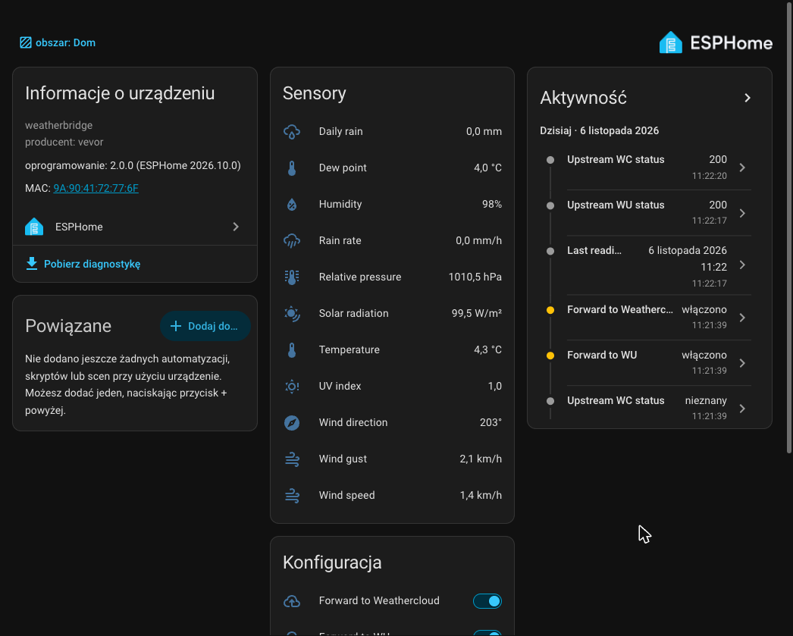
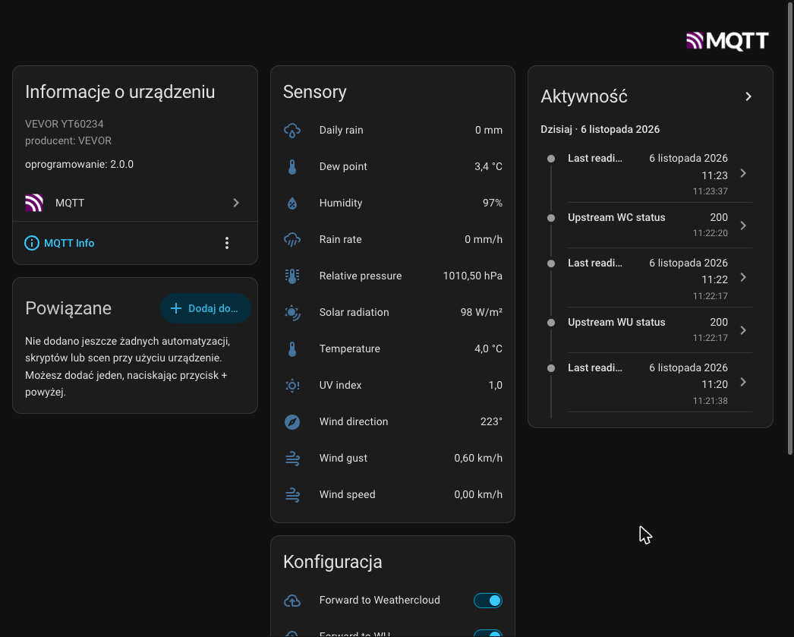
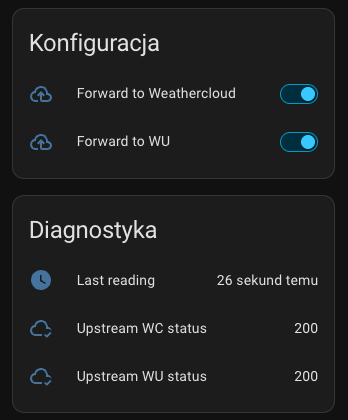
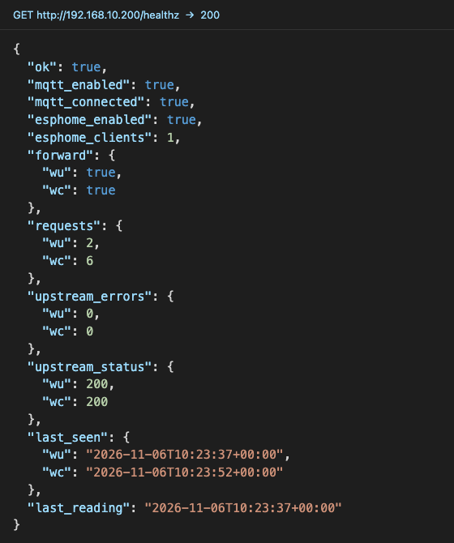
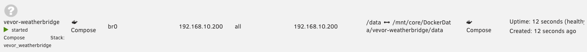
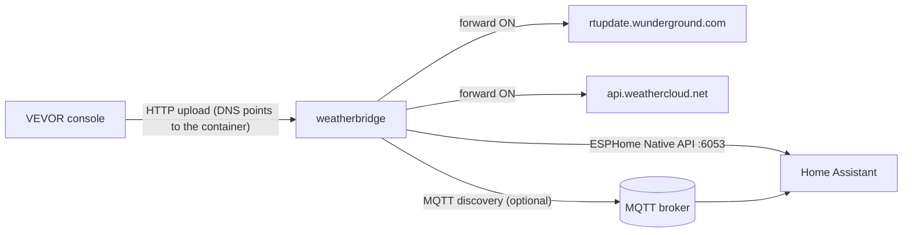

# VEVOR Weatherbridge

[](https://github.com/piciuok/meteostation-mitm/actions/workflows/ci.yml)
[](https://github.com/piciuok/meteostation-mitm/actions/workflows/esphome-compat.yml)

Local proxy for VEVOR weather station consoles (tested: **YT60234**; any console using the
Weather Underground upload protocol). It intercepts the console's uploads to Weather
Underground (WU) and Weathercloud (WC) and brings the data into **Home Assistant**, with or
without the cloud.

* **Home Assistant** as an **ESPHome device** (no broker needed) and/or via **MQTT discovery**,
  in metric units.
* **Forward or mock**: uploads are passed on to WU/WC and the real answer goes back to the
  console. When forwarding is off or the cloud is down, the console gets a recorded answer
  and never sees an error.
* **Switchable at runtime** from Home Assistant, separately for WU and WC.
* Station credentials are masked in logs, files and MQTT; the container runs unprivileged.

Forked from [C9H13NO3-dev/VevorWeatherbridge](https://github.com/C9H13NO3-dev/VevorWeatherbridge) (CC0-1.0).

## Contents

* [Screenshots](#screenshots)
* [How it works](#how-it-works)
* [Quick start](#quick-start)
* [Home Assistant](#home-assistant)
  * [Choosing a backend](#choosing-a-backend)
  * [Entities](#entities)
  * [Pressure trend package](#pressure-trend-package)
* [Configuration](#configuration)
* [Redirecting the console (DNS)](#redirecting-the-console-dns)
* [Deployment notes](#deployment-notes)
* [Operations](#operations)
* [Security](#security)
* [Troubleshooting and known issues](#troubleshooting-and-known-issues)
* [Development](#development)
* [Contributing](#contributing)
* [License](#license)

## Screenshots

| ESPHome device in Home Assistant | MQTT device in Home Assistant |
|---|---|
|  |  |

<details>
<summary>More: switches and diagnostics, <code>/healthz</code>, UnRAID</summary>

| Forward switches and diagnostics | `GET /healthz` |
|---|---|
|  |  |



</details>

## How it works



1. Your DNS server answers `rtupdate.wunderground.com` and `api.weathercloud.net` with the
   container's IP, so the console uploads to the container (plain HTTP, port 80).
2. The WU upload is parsed, converted to metric and published to Home Assistant.
   Weathercloud data is only kept for diagnostics.
3. The request is forwarded to the real service and the console gets its response, or the
   recorded response when forwarding is off or fails:

| Situation | Console receives | Recorded |
|---|---|---|
| Forward ON, upstream 2xx | upstream response | yes, in `data/responses/` |
| Forward ON, upstream 3xx/4xx (e.g. wrong station key) | upstream response | no |
| Forward ON, upstream 5xx, timeout, network or DNS error | recorded response | no |
| Forward OFF | recorded response | no |

Until something is recorded, the defaults are WU `success` and WC `200`. Upstream hosts are
resolved only through `UPSTREAM_DNS` (default `1.1.1.1,9.9.9.9`), never through your LAN DNS,
which points them back at the container.

## Quick start

Requirements: Docker with Compose, and a LAN IP for the container on which it can listen on
port 80 (macvlan/ipvlan network, or a host whose port 80 is free).

1. **Get the code and configure**

   ```bash
   git clone https://github.com/piciuok/meteostation-mitm.git vevor-weatherbridge
   ```

   ```bash
   cd vevor-weatherbridge && cp .env.example .env
   ```

   In `.env` enable at least one backend (`ESPHOME_ENABLED=true` and/or `MQTT_ENABLED=true`)
   and set `DOCKER_NETWORK` / `CONTAINER_IP`. Every variable is described in
   [`.env.example`](.env.example).

2. **Start** (local build; for the prebuilt image see [Deployment notes](#deployment-notes))

   ```bash
   docker compose up -d --build
   ```

3. **Check** from another machine in the LAN (`192.168.1.200` = your `CONTAINER_IP`)

   ```bash
   curl -s http://192.168.1.200/healthz
   ```

   ```bash
   curl -s -H 'Host: rtupdate.wunderground.com' 'http://192.168.1.200/weatherstation/updateweatherstation.php?ID=X&PASSWORD=Y&tempf=50'
   ```

   The second command returns `success`.

4. **Add to Home Assistant**
   * ESPHome: **Settings → Devices & services**, confirm the discovered `weather-station`
     device, or **Add integration → ESPHome** with the container IP and port `6053`.
   * MQTT: the device appears automatically.

5. **Point the console at the container**: add the DNS entries described in
   [Redirecting the console (DNS)](#redirecting-the-console-dns), then power-cycle the console.

## Home Assistant

### Choosing a backend

Both backends are off by default. The container refuses to start until at least one is
enabled. Enabling both creates two devices with the same data.

| | ESPHome (`ESPHOME_ENABLED`) | MQTT (`MQTT_ENABLED`) |
|---|---|---|
| Needs | Home Assistant only | MQTT broker + MQTT integration |
| Adding the device | ESPHome integration (mDNS discovery or by IP, port 6053) | automatic discovery |
| Encryption | `ESPHOME_ENCRYPTION_KEY`, like `api.encryption.key` in ESPHome | broker TLS / credentials |
| Values | float32, rounded by HA for display only | exact |
| Stability | protocol emulated by this project, [tested weekly](#development) | official HA MQTT discovery |

<details>
<summary>ESPHome backend details</summary>

* Protobuf messages come from the pinned [`aioesphomeapi`](https://github.com/esphome/aioesphomeapi),
  the client library Home Assistant uses; the tests connect with that client.
* The device has a fixed name (`ESPHOME_NAME`) and MAC (`ESPHOME_MAC`, derived from
  `DEVICE_ID` by default). HA uses the MAC as the device id, so keep both stable.
* Sensors appear once their field has been received at least once. When a new field
  appears, HA is asked to reconnect and re-reads the entity list (a few seconds).
* Without `ESPHOME_ENCRYPTION_KEY` anyone in the LAN can connect and toggle forwarding.
  Generate a key with `openssl rand -base64 32`.

</details>

<details>
<summary>MQTT topics</summary>

| Topic | Content |
|---|---|
| `meteo_proxy/state` | one retained JSON state; all entities read it via `value_template` |
| `meteo_proxy/status` | `online` / `offline` (LWT) |
| `meteo_proxy/forward/wu/set`, `…/wc/set` | switch commands `ON` / `OFF` |
| `homeassistant/status` | on `online`, discovery and state are published again |
| `homeassistant/<sensor\|switch>/weather_station/<key>/config` | discovery (retained) |

`meteo_proxy` is `BASE_TOPIC`, `homeassistant` is `DISCOVERY_PREFIX`, `weather_station` is
`DEVICE_ID`.

</details>

### Entities

Entity IDs below assume `DEVICE_NAME=Weather Station`; they are the same for both backends.

| Entity | WU field | Unit |
|---|---|---|
| `sensor.weather_station_temperature` | `tempf` | °C |
| `sensor.weather_station_humidity` | `humidity` | % |
| `sensor.weather_station_dew_point` | `dewptf` | °C |
| `sensor.weather_station_wind_chill` | `windchillf` | °C |
| `sensor.weather_station_indoor_temperature` | `indoortempf` | °C |
| `sensor.weather_station_indoor_humidity` | `indoorhumidity` | % |
| `sensor.weather_station_wind_speed` | `windspeedmph` | km/h |
| `sensor.weather_station_wind_gust` | `windgustmph` | km/h |
| `sensor.weather_station_wind_direction` | `winddir` | ° |
| `sensor.weather_station_rain_rate` | `rainin` | mm/h |
| `sensor.weather_station_daily_rain` / `weekly_rain` / `monthly_rain` / `yearly_rain` | `dailyrainin` … `yearlyrainin` | mm |
| `sensor.weather_station_solar_radiation` | `solarradiation` | W/m² |
| `sensor.weather_station_uv_index` | `UV` | – |
| `sensor.weather_station_relative_pressure` | `baromin` | hPa |
| `sensor.weather_station_absolute_pressure` | `absbaromin` | hPa |
| `sensor.weather_station_last_reading` | – | timestamp (diagnostic) |
| `sensor.weather_station_upstream_wu_status` / `upstream_wc_status` | – | last HTTP code or `error` (diagnostic) |
| `switch.weather_station_forward_to_wu` / `forward_to_weathercloud` | – | forwarding on/off |

<details>
<summary>Parsing rules</summary>

* Conversions: °C = (°F − 32)·5/9, km/h = mph·1.609344, mm = in·25.4, hPa = inHg·33.8639.
  Rounded to 0.1; humidity and wind direction to integers. `UNITS=imperial` keeps WU units.
* Field names are case-insensitive (the YT60234 sends `solarRadiation`).
* `-9999`, empty and `NaN` values are skipped. Garbage values (e.g. `-117.-5`) and negative
  values of non-negative quantities are rejected and listed in `data/last_request_wu.json`.
* Unknown fields are listed (names only) in `data/last_request_wu.json` and, with MQTT, in
  the attributes of `last_reading`.
* Device classes and state classes follow HA conventions (rain totals are `total_increasing`).
* No `weather.*` entity or forecast is created.

</details>

### Pressure trend package

[`homeassistant/weather_station.yaml`](homeassistant/weather_station.yaml) adds
`sensor.weather_station_pressure_change_3h`. Copy it to `/config/packages/` (needs
`packages: !include_dir_named packages` under `homeassistant:`) and restart HA.

## Configuration

Everything is set in `.env`; [`.env.example`](.env.example) documents each variable.
The compose files contain no secrets.

| Variable | Default | Purpose |
|---|---|---|
| `ESPHOME_ENABLED` / `MQTT_ENABLED` | `false` | Home Assistant backends (enable at least one) |
| `ESPHOME_ENCRYPTION_KEY` | – | Noise key (base64, 32 bytes); empty = plaintext |
| `ESPHOME_NAME` / `ESPHOME_MAC` / `ESPHOME_PORT` / `ESPHOME_MDNS` | `weather-station` / derived / `6053` / `true` | ESPHome device |
| `MQTT_HOST` / `MQTT_PORT` / `MQTT_USER` / `MQTT_PASSWORD` | – / `1883` / – / – | MQTT broker |
| `DEVICE_NAME` / `DEVICE_ID` / `DEVICE_MODEL` / `DEVICE_MANUFACTURER` | `Weather Station` / `weather_station` / `VEVOR YT60234` / `VEVOR` | HA device |
| `DISCOVERY_PREFIX` / `BASE_TOPIC` | `homeassistant` / `meteo_proxy` | MQTT topics |
| `FORWARD_WU` / `FORWARD_WC` | `true` | initial forwarding; a toggle from HA is remembered |
| `UPSTREAM_DNS` / `UPSTREAM_TIMEOUT` | `1.1.1.1,9.9.9.9` / `8` | upstream resolvers, timeout in seconds |
| `WU_USERNAME` / `WU_PASSWORD` | – | override the station ID/key sent to WU |
| `UNITS` | `metric` | `imperial` keeps WU units |
| `DOCKER_NETWORK` / `CONTAINER_IP` | `br0` / `192.168.1.200` | used by the compose files only |
| `TZ` / `LOG_LEVEL` | – / `INFO` | time zone, log level |
| `HTTP_PORT` / `DATA_DIR` | `80` / `/data` | inside the container |

Files in `./data`:

| File | Content |
|---|---|
| `state.json` | forwarding state set from HA, last sensor values |
| `responses/wu.json`, `responses/wc.json` | last successful upstream response (used as the mock) |
| `last_request_wu.json`, `last_request_wc.json` | last request, masked: fields, unknown/rejected fields, response source |

## Redirecting the console (DNS)

Make the DNS server your console uses answer both hostnames with the container IP. Then
power-cycle the console (it caches DNS).

Before you start:

* The console must use that DNS server (normally the router, via DHCP). If it ignores DHCP,
  see *Console with a hard-coded DNS server* below.
* The upload must be plain HTTP. Check your router's connection list: if the console talks
  to WU on port 443, it cannot be intercepted.
* Most methods match the exact hostname only. Add every name the console uses (check your
  resolver's log or cache).

Check from any machine using the same DNS server; the answer must be the container IP:

```bash
nslookup rtupdate.wunderground.com
```

<details>
<summary>Pi-hole v6</summary>

UI: **Settings → Local DNS Records**, add both names with the container IP. CLI (replaces the
whole list, include existing entries; in Docker use `FTLCONF_dns_hosts`):

```bash
sudo pihole-FTL --config dns.hosts '[ "192.168.1.200 rtupdate.wunderground.com api.weathercloud.net" ]'
```

[Pi-hole docs](https://docs.pi-hole.net/ftldns/configfile/#hosts)

</details>

<details>
<summary>AdGuard Home</summary>

UI: **Filters → DNS rewrites → Add DNS rewrite**, one per hostname. Or in `AdGuardHome.yaml`
(edit while AdGuard Home is stopped):

```yaml
filtering:
  rewrites:
    - domain: rtupdate.wunderground.com
      answer: 192.168.1.200
      enabled: true
    - domain: api.weathercloud.net
      answer: 192.168.1.200
      enabled: true
```

[AdGuard Home docs](https://adguard-dns.io/kb/adguard-home/faq/)

</details>

<details>
<summary>dnsmasq / Asuswrt-Merlin</summary>

Add to the dnsmasq configuration (Merlin: `/jffs/configs/dnsmasq.conf.add`, with
**Administration → System → Enable JFFS custom scripts and configs**), then restart dnsmasq
(Merlin: `service restart_dnsmasq`):

```
address=/rtupdate.wunderground.com/192.168.1.200
address=/api.weathercloud.net/192.168.1.200
```

`address=` also matches subdomains. If the console uses IPv6, also add
`local=/rtupdate.wunderground.com/` (dnsmasq ≥ 2.86 forwards AAAA queries otherwise).
[dnsmasq man page](https://thekelleys.org.uk/dnsmasq/docs/dnsmasq-man.html),
[Merlin wiki](https://github.com/RMerl/asuswrt-merlin.ng/wiki/Custom-domains-with-dnsmasq)

</details>

<details>
<summary>OpenWrt</summary>

LuCI: **Network → DNS → DNS Records → Hostnames** (OpenWrt 25.12; in 24.10 under
**Network → DHCP and DNS**). CLI:

```bash
uci add dhcp domain && uci set dhcp.@domain[-1].name='rtupdate.wunderground.com' && uci set dhcp.@domain[-1].ip='192.168.1.200'
```

```bash
uci add dhcp domain && uci set dhcp.@domain[-1].name='api.weathercloud.net' && uci set dhcp.@domain[-1].ip='192.168.1.200'
```

```bash
uci commit dhcp && /etc/init.d/dnsmasq restart
```

DNS rebind protection does not affect local entries.

</details>

<details>
<summary>OPNsense / pfSense</summary>

* OPNsense: **Services → Unbound DNS → Overrides → Host overrides → +**: Host `rtupdate`,
  Domain `wunderground.com`, IP = container IP; then Host `api`, Domain `weathercloud.net`.
  [Docs](https://docs.opnsense.org/manual/unbound.html)
* pfSense: **Services → DNS Resolver → General Settings → Host Overrides → Add**, the same two
  entries, then Apply Changes.
  [Docs](https://docs.netgate.com/pfsense/en/latest/services/dns/resolver-host-overrides.html)

</details>

<details>
<summary>UniFi / TP-Link Omada</summary>

* UniFi Network 9.4+: **Settings → Policy Table → Create New Policy → DNS**, type
  **Host (A)**, one per hostname (9.3: **Settings → Policy Engine → DNS**).
  [Help article](https://help.ui.com/hc/en-us/articles/15179064940439)
* Omada (controller 5.15.20+, Omada gateway): **Network Config → Network Settings → LAN →
  LAN DNS**, type **IP**. [Docs](https://support.omadanetworks.com/us/document/40077/)

</details>

<details>
<summary>MikroTik (RouterOS 7)</summary>

The router must answer DNS for the LAN (`/ip dns set allow-remote-requests=yes`, with port 53
blocked from WAN) and hand out its own IP as DNS server via DHCP.

```bash
/ip dns static add name=rtupdate.wunderground.com type=A address=192.168.1.200 comment="vevor-weatherbridge"
```

```bash
/ip dns static add name=api.weathercloud.net type=A address=192.168.1.200 comment="vevor-weatherbridge"
```

```bash
/ip dns cache flush
```

</details>

<details>
<summary>Routers without custom DNS records (FRITZ!Box, stock ASUS, TP-Link Archer/Deco)</summary>

Run Pi-hole or AdGuard Home (see above) and set it as the DNS server in the router's DHCP
settings.

</details>

<details>
<summary>Console with a hard-coded DNS server</summary>

Redirect the console's DNS traffic (port 53) to your resolver on the router. These are
common community patterns, not vendor recipes; test them. MikroTik, for a console at
`192.168.1.89`:

```bash
/ip firewall nat add chain=dstnat src-address=192.168.1.89 protocol=udp dst-port=53 action=redirect to-ports=53 comment="vevor-weatherbridge"
```

```bash
/ip firewall nat add chain=dstnat src-address=192.168.1.89 protocol=tcp dst-port=53 action=redirect to-ports=53 comment="vevor-weatherbridge"
```

OpenWrt: [DNS hijacking guide](https://openwrt.org/docs/guide-user/firewall/fw3_configurations/intercept_dns).
This does not help against DNS-over-HTTPS/TLS or hard-coded IP addresses.

</details>

## Deployment notes

### Prebuilt image

CI publishes `ghcr.io/piciuok/meteostation-mitm`: `latest` from `main`, `X.Y.Z` and `X.Y` from
`v*` tags. [`docker-compose.ghcr.yml`](docker-compose.ghcr.yml) uses it instead of a local
build, so image update tools (e.g. What's Up Docker) can track it:

```bash
docker compose -f docker-compose.ghcr.yml up -d
```

The local build in `docker-compose.yml` is labelled `wud.watch=false`.

### UnRAID

* Use the existing ipvlan/macvlan network (`br0`) with a fixed `CONTAINER_IP`; no port
  mappings are needed.
* With the Compose Manager plugin, point the stack at the directory with
  `docker-compose.yml` and `.env`.
* The UnRAID host cannot reach containers on an ipvlan network: test from another machine.

## Operations

* **Health:** `GET /healthz` returns enabled backends, MQTT/ESPHome connection state,
  forwarding state, request and error counters, last upstream status and timestamps. The
  Docker healthcheck uses it; the container stays healthy while MQTT is down.
* **Logs:** one INFO line per upload (`WU: 14 fields → HA, forward 200`); upstream failures and
  fallbacks at WARNING. Unknown requests are logged as `404 …`.
* **Reset forwarding** to the `.env` defaults: delete `data/state.json` and restart.
* **Rollback:** remove the DNS entries and flush the DNS cache, power-cycle the console (it
  uploads to the cloud directly again), run `docker compose down`, then delete the device in
  Home Assistant (ESPHome or MQTT integration).

## Security

| Area | Measure |
|---|---|
| Credentials | Station ID/password (WU) and wid/key (WC) are masked in logs, `data/` files and MQTT; a global log filter also scrubs third-party log records. |
| Forwarding | Only to `wunderground.com` / `weathercloud.net` (and their subdomains); the `Host` header is normalised, so the proxy cannot reach other hosts. Upstream answers over 64 KiB are discarded. |
| ESPHome API | Optional Noise encryption (recommended). Hello required first and within 10 s, idle clients dropped after 120 s, at most 8 connections. |
| MQTT | Use a dedicated broker user, ideally restricted to `meteo_proxy/#` and `homeassistant/#`. Topic settings are validated (no wildcards). |
| Container | Runs as uid 10001 with only `CAP_NET_BIND_SERVICE`; compose adds `read_only`, `no-new-privileges`, `cap_drop: ALL`. The entrypoint takes over ownership of existing `./data` files. |
| Secrets | Only in `.env` (git-ignored). |

Report vulnerabilities privately, see [SECURITY.md](SECURITY.md).

## Troubleshooting and known issues

| Symptom | Cause / fix |
|---|---|
| Container exits with `Configuration error: …` | Enable a backend or fix the named variable in `.env`. |
| No `WU: …` log lines | The console does not reach the container: check DNS (`nslookup`), power-cycle the console, check that it uses HTTP. |
| `404 GET host=… path=…` in the log | The console uses a host or path not handled yet; open an issue with the masked line. |
| Solar radiation missing at high sun | Known console firmware bug: values above about 367 W/m² arrive as garbage (`-117.-5`) and are rejected ([upstream #9](https://github.com/C9H13NO3-dev/VevorWeatherbridge/issues/9)). |
| Values like `3.2999999` in history (ESPHome) | ESPHome sends float32; HA rounds only for display. Use MQTT for exact values. |
| ESPHome device not discovered | mDNS does not cross your network; add it by IP and port 6053. |

Weathercloud uploads are parsed from the `/v01/set/wid/<id>/key/<key>/<name>/<value>` form
and are not mapped to Home Assistant entities yet.

## Development

```bash
pip install -r requirements-dev.txt && pytest -q
```

The test suite covers parsing and conversions, forwarding and mocking with a fake upstream,
credential masking, MQTT discovery, the ESPHome Native API with the real `aioesphomeapi`
client (plaintext and encrypted), and security regressions.

| Workflow | When | What |
|---|---|---|
| [`ci.yml`](.github/workflows/ci.yml) | push, pull request, `v*` tag | tests; image build and push to GHCR on `main` and tags |
| [`esphome-compat.yml`](.github/workflows/esphome-compat.yml) | weekly, on ESPHome code changes, on upstream releases | ESPHome tests against the `aioesphomeapi` versions used by this repo, the latest Home Assistant and ESPHome releases, HA dev and PyPI latest |
| [`upstream-watch.yml`](.github/workflows/upstream-watch.yml) | hourly | detects new Home Assistant / ESPHome / `aioesphomeapi` releases and runs `esphome-compat` |

<details>
<summary>Code layout</summary>

| Path | Purpose |
|---|---|
| `weatherstation.py` | entry point |
| `weatherbridge/app.py` | HTTP app: routing, forward/mock, diagnostics |
| `weatherbridge/parsing.py` | WU field table, conversions, WC parsing, masking |
| `weatherbridge/upstream.py` | upstream resolver, forwarder, recorded responses |
| `weatherbridge/esphome.py` | ESPHome Native API server (plaintext/Noise), mDNS |
| `weatherbridge/mqtt.py` | MQTT discovery, state, switch commands |
| `weatherbridge/entities.py` | entities shared by both backends |
| `weatherbridge/config.py` | configuration and validation |
| `weatherbridge/state.py` | runtime state, `data/state.json` |
| `weatherbridge/logsafe.py` | log scrubbing |
| `docker-entrypoint.sh` | data ownership, privilege drop |
| `scripts/esphome_versions.py` | version lookup for the compatibility workflow |

</details>

## Contributing

Pull requests are welcome; every change is reviewed by the maintainer before it is merged.
Please run `pytest -q` and keep station credentials out of issues, logs and screenshots.

## License

[CC0 1.0 Universal](LICENSE). Original relay by
[C9H13NO3-dev](https://github.com/C9H13NO3-dev/VevorWeatherbridge), inspired by
[@vlovmx](https://github.com/vlovmx).
